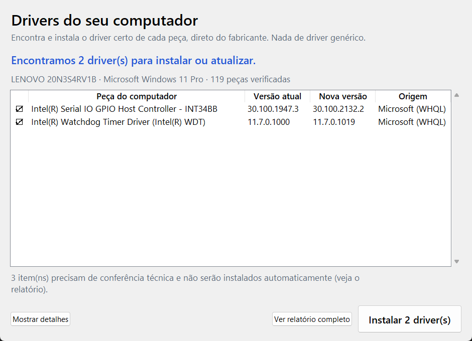
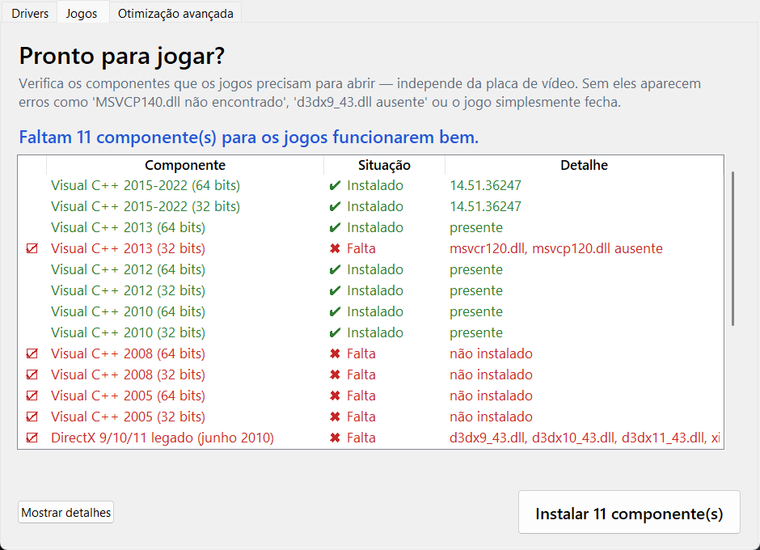
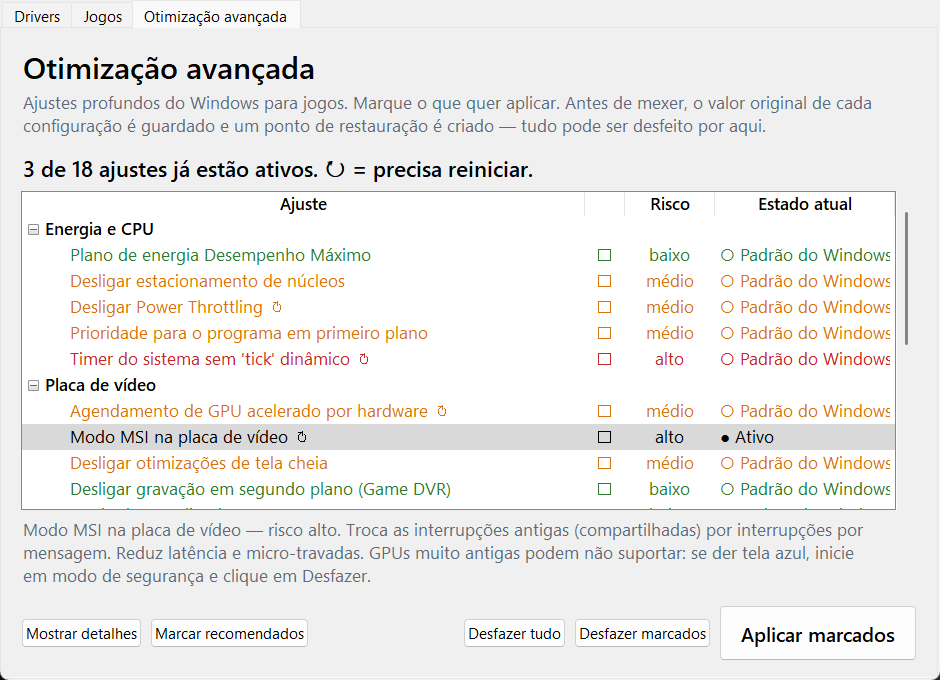

# DriverPrecision

[](https://github.com/joao-eder/driverprecision/actions/workflows/ci.yml)
[](https://github.com/joao-eder/driverprecision/releases/latest)
[](LICENSE)

Identifica o hardware do PC e instala o driver **correto** para cada dispositivo: o publicado para aquele modelo e Hardware ID exato. Nada de pacote genérico, nada de "driver booster". Também deixa o PC **pronto para jogar** (Visual C++, DirectX, .NET...) e traz uma tela de **otimização avançada** com desfazer.

*English summary [below](#english).*

## Download

Vá em **[Releases](https://github.com/joao-eder/driverprecision/releases/latest)** e baixe:

| Arquivo | Para quem |
|---|---|
| `DriverPrecision.exe` | Qualquer pessoa. Não precisa de Python. Dois cliques e pronto. |
| `DriverPrecision-vX.Y.Z.zip` | Quem tem Python 3.10+ e prefere rodar o código-fonte. |
| `SHA256SUMS.txt` | Hashes para conferir o download. |

O `.exe` é gerado pelo GitHub Actions direto deste código (veja [release.yml](.github/workflows/release.yml)) e não tem assinatura de código: o Windows SmartScreen pode avisar "editor desconhecido". Clique em *Mais informações → Executar assim mesmo*, ou use o `.zip` com Python.

Conferir o hash no PowerShell:
```powershell
Get-FileHash .\DriverPrecision.exe -Algorithm SHA256
```

## Uso (para todo mundo)

1. Dois cliques no `DriverPrecision.exe` e clique em **Sim** no aviso do Windows (precisa de administrador para instalar drivers).
2. Clique em **Verificar agora**. Em 1 a 3 minutos aparece a lista do que precisa ser instalado ou atualizado, já marcado.
3. Clique em **Instalar**. O programa cria um ponto de restauração, baixa cada driver do fabricante, confere se o arquivo é autêntico e instala sozinho.
4. Se pedir, reinicie o computador.



Só entra na instalação automática o que é seguro: driver ligado ao Hardware ID ou ao modelo exato e com versão comprovadamente mais nova. Itens duvidosos (`VERIFICAR`), BIOS e firmware ficam de fora e aparecem no relatório (botão **Ver relatório completo**).

## Aba Jogos: tudo o que os jogos precisam para abrir

Independente da potência do PC, jogos dependem de bibliotecas que o Windows não traz. Sem elas aparecem erros como *"MSVCP140.dll não encontrado"*, *"d3dx9_43.dll ausente"*, controle que não responde ou jogo que fecha sem aviso.



| Componente | Por que importa |
|---|---|
| Visual C++ 2005, 2008, 2010, 2012, 2013, 2015-2022 (32 e 64 bits) | Cada jogo usa a versão com que foi compilado; jogo 32 bits precisa da versão 32 bits mesmo no Windows 64. A 2015-2022 abaixo de **14.40** faz jogos novos fecharem ao abrir. |
| DirectX 9/10/11 legado (junho 2010) | O Windows 10/11 **não** traz d3dx9_43, XInput 1.3 e XAudio 2.7. |
| .NET Framework 3.5 e 4.8, .NET Desktop Runtime 8 e 10 | Launchers, ferramentas de mod e jogos indie. |
| XNA 4.0, OpenAL | Indies e clássicos (Terraria, Fez, emuladores...). |
| WebView2 | Launchers modernos ficam com tela branca sem ele. |
| DirectPlay (opcional), Vulkan (checagem) | Multiplayer de jogos antigos; Vulkan vem com o driver de vídeo. |

Tudo é baixado dos links oficiais (Microsoft; OpenAL da Creative) e só executa com assinatura digital válida do fabricante.

## Aba Otimização avançada



Ajustes profundos que fazem diferença em jogo (não é "limpar arquivos temporários"). Cada um mostra o risco, o estado atual no seu PC e o que faz em português simples.

| Categoria | Ajustes |
|---|---|
| Energia e CPU | Plano Desempenho Máximo · estacionamento de núcleos · Power Throttling · prioridade do primeiro plano (`Win32PrioritySeparation`) · timer sem tick dinâmico (BCD) |
| Placa de vídeo | HAGS · modo MSI na GPU · otimizações de tela cheia · Game DVR · Modo de Jogo · economia de energia do PCIe (ASPM) |
| Agendador multimídia | `SystemResponsiveness` 0 e prioridade de GPU/CPU para a tarefa *Games* no MMCSS |
| Rede | `NetworkThrottlingIndex` · algoritmo de Nagle (TcpAckFrequency/TCPNoDelay) · compartilhamento P2P de atualizações · economia de energia do Wi-Fi |
| Mouse e teclado | aceleração do mouse · suspensão seletiva de USB · repetição do teclado |
| Windows | apps em segundo plano · efeitos visuais · Inicialização rápida · telemetria · anúncios e apps sugeridos · busca na web (Bing) · atraso da inicialização · hibernação |
| Disco | TRIM do SSD · registro de último acesso (NTFS) |
| Segurança x desempenho | Integridade de Memória (VBS/HVCI) — ganha FPS, mas reduz proteção; alguns anti-cheats exigem ligado |

**Segurança:** antes de aplicar, o valor original de cada chave vai para `%LOCALAPPDATA%\DriverPrecision\otimizacao_backup.json` e é criado um ponto de restauração. **Desfazer** devolve exatamente o que estava antes (inclusive apaga o que não existia). O ajuste de timer é bloqueado se o BitLocker estiver ativo, para não pedir a chave de recuperação no próximo boot.

Quer propor um ajuste? Ele é só um item de dados em [`driverprecision_otimiza.py`](driverprecision_otimiza.py) — veja o [CONTRIBUTING](CONTRIBUTING.md).

## Uso avançado (linha de comando)

Com o `.zip` e Python 3.10+:
```
python driverprecision.py                     # abre a janela
python driverprecision.py scan                # somente leitura, gera relatório
python driverprecision.py auto                # verifica e instala os recomendados, sem perguntas (admin)
python driverprecision.py baixar ID [ID ...]  # baixa e valida, não instala
python driverprecision.py instalar [ID ...]   # instala os IDs dados ou os recomendados (admin; pede "SIM", ou --sim)
```

Os IDs (`LEN:...`, `DELL:...`, `HP:...`, `WU:...`, `CAT:...`) aparecem no relatório.
Na linha de comando a saída fica em `DriverPrecision_saida\` (relatório HTML + `ultimo_scan.json`) na pasta atual; pela janela, em `%LOCALAPPDATA%\DriverPrecision\saida`. Cache em `%LOCALAPPDATA%\DriverPrecision\cache`.

Opções do scan: `--sem-oem`, `--sem-wu`, `--sem-catalogo`, `--nao-abrir`.

> **Privacidade:** o relatório e o `ultimo_scan.json` contêm o inventário e o número de série do seu PC. Não publique esses arquivos. Nenhum dado é enviado a terceiros: o programa só *baixa* catálogos públicos da Lenovo, Dell, HP e Microsoft.

## Como identifica

1. **Inventário (WMI):** fabricante, modelo, SKU, placa-mãe, BIOS e build do Windows. Para cada dispositivo: Hardware IDs, Compatible IDs, erro do Gerenciador de Dispositivos e driver em uso (versão, data, provedor, INF).
   - INF `oemNN.inf` = driver de fabricante. Outro nome = driver inbox (genérico) do Windows.
   - O casamento usa os Hardware IDs + os Compatible IDs que ainda identificam o chip (`VEN&DEV`, `VID&PID`). IDs só de classe (`PCI\CC_`, `USB\CLASS_`) nunca entram.

2. **Fontes, em ordem de confiança**

| # | Fonte | Chave de busca | Integridade |
|---|-------|----------------|-------------|
| 1 | Lenovo `catalog/<MT>_Win11.xml` | Machine Type + Hardware ID + versão do driver | SHA-256 do descritor e do instalador |
| 1 | Dell `CatalogPC.cab` | SystemSKU + `PCIInfo` + SO | MD5 + Authenticode |
| 1 | HP HPIA `platformList` / `ref/<plat>_64_<SO>.cab` | Platform ID (placa) + Hardware ID + SO | SHA-256 do softpaq |
| 2 | Windows Update (API WUA, só busca) | Hardware ID casado pelo próprio Windows | assinado pelo WU |
| 3 | Microsoft Update Catalog | Hardware ID mais específico (SUBSYS / VID&PID) | Authenticode |

   - **Catalog:** a busca do site é textual, então cada resultado é conferido na página do pacote. O Hardware ID do aparelho tem que estar **literalmente** em "Supported Hardware IDs". Se não estiver, ou se o provedor for a própria Microsoft (genérico), o pacote é descartado. Resultado que só bate no chip (`VEN&DEV` sem `SUBSYS`) não é recomendado.
   - **PC montado ou marca sem catálogo público:** usa as fontes 2 e 3 e mostra a placa-mãe para você buscar no site do fabricante dela.

3. **Status no relatório**

| Status | Significado |
|---|---|
| SEM DRIVER / INSTALAR | dispositivo com erro ou sem driver; INSTALAR = driver exato encontrado |
| SUBSTITUIR | está com driver inbox genérico e existe driver específico |
| ATUALIZAR | a fonte informa versão de driver mais nova que a instalada |
| VERIFICAR | a fonte só informa a versão do *pacote*, não a do driver: confira nas notas |
| GENÉRICO | inbox em classe crítica (vídeo, rede, áudio...) e nenhuma fonte publica driver específico |
| OK | igual ou mais novo, ou driver de classe padrão do Windows (USB hub, HID, NVMe padrão...) — nesses o driver de classe é o correto e o fabricante não publica outro |

Se o fabricante do PC tiver driver e houver outro mais novo fora dele (ex.: direto da Intel no Catalog), o relatório mostra os dois, mas recomenda o do fabricante.

## Como a instalação é protegida

- Exige administrador. Antes de instalar, cria um ponto de restauração do Windows; se não conseguir, pergunta se quer continuar.
- Todo arquivo baixado é validado (hash do catálogo do fabricante + assinatura digital válida). Se falhar, o arquivo é apagado e nada roda.
- **BIOS e firmware nunca são instalados automaticamente:** use `baixar`, leia as notas e rode manualmente, com o carregador conectado.
- Lenovo: `ExtractCommand` + `Install` do descritor oficial. Dell: `DUP.exe /s`. HP: `spXXXX.exe /s`. Catalog: `expand` + `pnputil /add-driver /install`. WU: API do Windows Update.

## Limitações conhecidas

- A Dell não publica Hardware ID de alguns pacotes (áudio, USB etc.): eles aparecem na seção "pacotes do modelo" como VERIFICAR.
- Lenovo consumer (IdeaPad/Legion) nem sempre tem catálogo público por MT: nesse caso usa WU + Catalog.
- GPUs dedicadas (NVIDIA/AMD) em PCs montados: o Catalog tem os drivers WHQL, mas o mais recente costuma sair antes no site do fabricante da GPU.
- Somente Windows 10/11 x64.

## Desenvolvimento

```
python -m unittest discover -s tests -v
```
Veja [CONTRIBUTING.md](CONTRIBUTING.md) para adicionar um fabricante novo. Mudanças em [CHANGELOG.md](CHANGELOG.md).

## Licença

[MIT](LICENSE). Use, modifique e distribua à vontade. Sem garantia: driver errado pode deixar o PC instável, então leia o relatório antes de instalar.

---

## English

**DriverPrecision** inventories a Windows PC and finds the *correct* driver for each device — the one published for that exact model and Hardware ID — never a generic package.

- **Sources, in order of trust:** the PC maker's official catalog (Lenovo by Machine Type, Dell by SystemSKU, HP by Platform ID), then Windows Update (search only), then the Microsoft Update Catalog. Every Catalog hit is verified against the package's official *Supported Hardware IDs* list; generic Microsoft drivers and chip-only (`VEN&DEV` without `SUBSYS`) matches are not recommended.
- **Download:** get `DriverPrecision.exe` (no Python needed) or the source `.zip` from [Releases](https://github.com/joao-eder/driverprecision/releases/latest).
- **Use:** double-click, accept the UAC prompt, click *Verificar agora* (scan), then *Instalar* (install). It creates a restore point, downloads each driver from the vendor, verifies hash + Authenticode signature and installs silently. Only confident matches with a proven newer version are auto-installed; BIOS/firmware never is. Power users: `python driverprecision.py scan | auto | baixar | instalar`.
- The UI and report are in Portuguese (pt-BR). Translations are welcome.
- **Privacy:** the report contains your PC's inventory and serial number; nothing is uploaded anywhere.

License: MIT.
