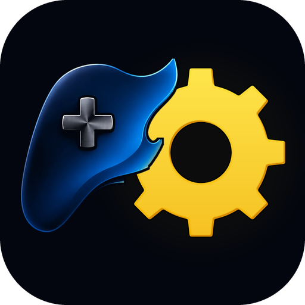
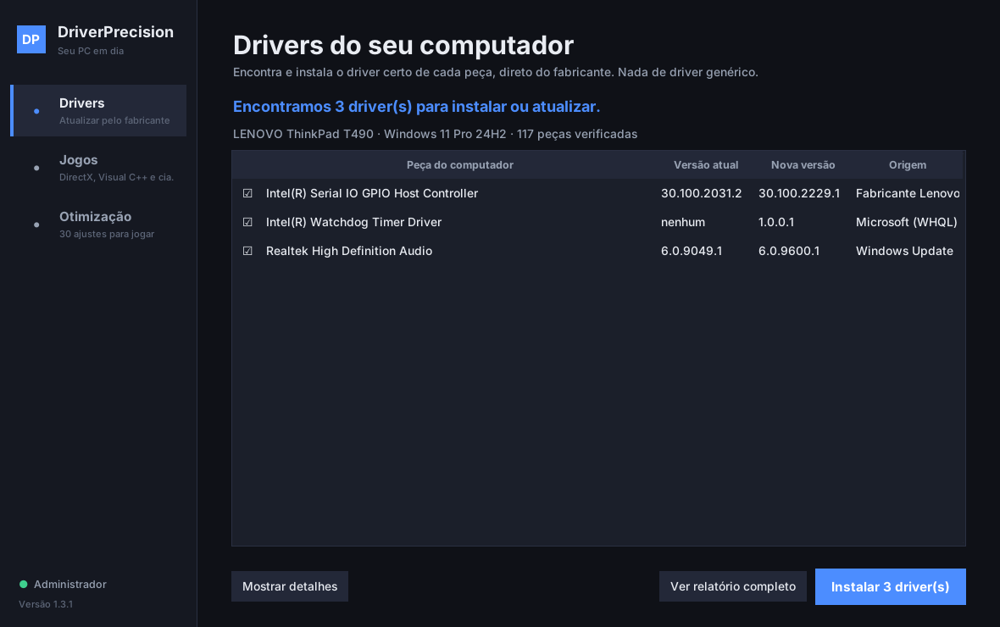
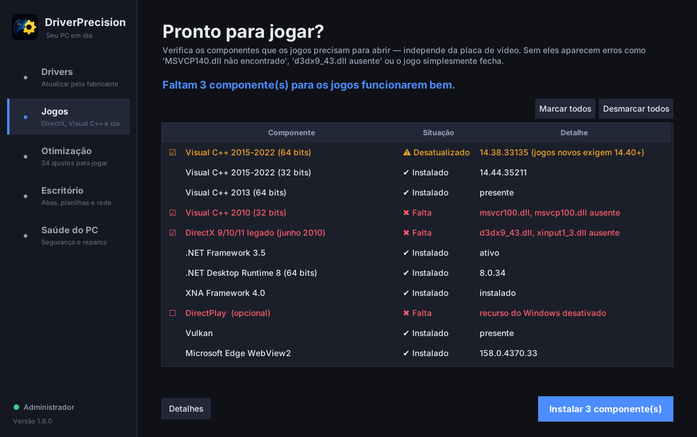
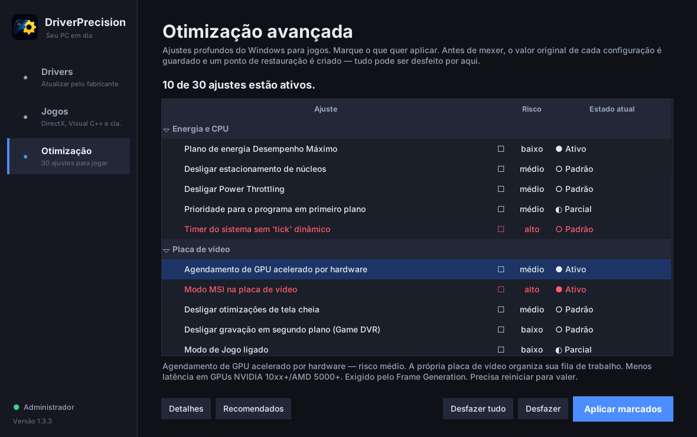
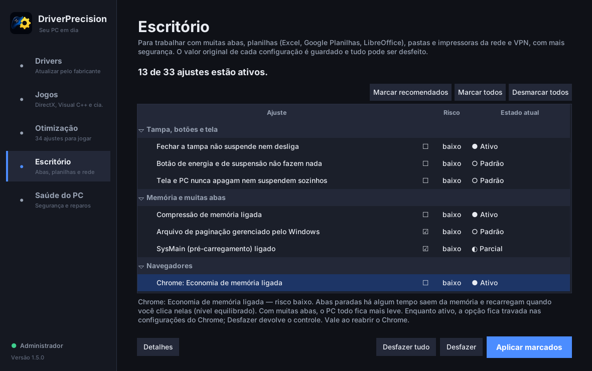
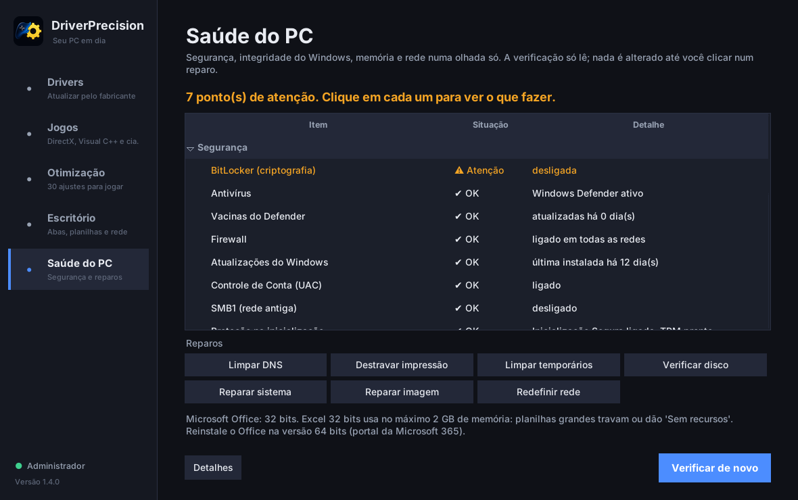

# 
DriverPrecision — Drivers, Jogos e Desempenho

  

  
  
  
  
  
  

Programa para **Windows 10 e 11** que encontra e instala o **driver correto de cada peça** do computador, deixa o PC **pronto para jogar** e aplica **otimizações que sempre podem ser desfeitas**:

- **Drivers** do fabricante da peça (Intel, AMD, NVIDIA, Realtek...) ou do fabricante do PC (Lenovo, Dell, HP)
- **Jogos**: Visual C++, DirectX, .NET e tudo o que os jogos precisam para abrir
- **Otimização** para jogos e para **Escritório** (muitas abas, planilhas, rede)
- **Saúde do PC**: segurança, integridade do Windows e reparos com um clique

---

## Principais recursos

- **Driver da peça certa**, nunca genérico.
    - Identifica cada peça pelo Hardware ID e usa o driver de quem a fabricou.
    - Peça trocada (ex.: Wi-Fi Realtek de fábrica substituído por Intel) recebe o driver do novo fabricante.
- **Só versões estáveis**: beta, preview, insider e release candidate ficam de fora.
- **Fontes oficiais**: catálogos da Lenovo, Dell e HP, **site da NVIDIA** (Game Ready WHQL), Windows Update e Catálogo da Microsoft, com hash e assinatura digital conferidos antes de instalar.
- **Escolha por tipo de peça**:
    - Wi-Fi, Bluetooth, rede e vídeo → a versão estável mais nova.
    - Áudio, chipset, disco, térmico, touchpad e câmera → a validada pelo fabricante do PC.
- **BIOS nunca é tocada**: o programa não verifica, não baixa e não instala BIOS ou firmware. A versão instalada aparece na Saúde do PC.
- **Tudo com desfazer**: cada ajuste guarda o valor original e volta exatamente como estava.
- **PC de empresa respeitado**: em domínio, Entra ID ou Intune, o que a TI controla fica bloqueado.
- **Testado em Windows real** a cada versão, aplicando e desfazendo cada ajuste de verdade.
- **100% transparente**: código aberto em Python, sem instalador e sem serviço rodando em segundo plano.

---

## Telas

| Jogos | Otimização |
|---|---|
|  |  |
| **Escritório** | **Saúde do PC** |
|  |  |

---

## Requisitos

- **Windows 10 ou 11, 64 bits**
- **Administrador**
    - Pedido uma vez, ao abrir. Sem ele, o programa só verifica.
- **Internet**
    - Para consultar as fontes e baixar drivers e componentes.
- **Python 3.10+** (opcional)
    - Só para rodar pelo código-fonte; o `.exe` não precisa.

---

## Download e uso

1. Baixe o **`DriverPrecision.exe`** em **[Releases](https://github.com/joao-eder/driverprecision/releases/latest)**.
2. Abra e aceite o aviso do Windows.
    - Se aparecer "editor desconhecido": **Mais informações → Executar assim mesmo** (o `.exe` é compilado pelo GitHub Actions a partir deste código, sem certificado pago).
3. Na tela **Drivers**, clique em **Verificar agora** e depois em **Instalar**.
4. Use as telas **Jogos**, **Otimização**, **Escritório** e **Saúde do PC** como quiser — tudo pode ser desfeito.

Conferir o arquivo baixado: `Get-FileHash .\DriverPrecision.exe -Algorithm SHA256` e compare com o `SHA256SUMS.txt` da release.

---

## Documentação

- **[Como funciona](docs/COMO-FUNCIONA.md)**: fontes, regras de escolha do driver, cada ajuste, linha de comando e limitações.
- **[Histórico de versões](CHANGELOG.md)**
- **[Como contribuir](CONTRIBUTING.md)** · **[Segurança](SECURITY.md)**

---

## Créditos

- [Microsoft](https://www.catalog.update.microsoft.com)
    - Windows Update e Microsoft Update Catalog
- [Lenovo](https://pcsupport.lenovo.com), [Dell](https://www.dell.com/support), [HP](https://support.hp.com)
    - Catálogos públicos de drivers por modelo
- Intel, AMD, NVIDIA, Realtek e demais fabricantes
    - Drivers das peças, publicados e assinados por eles

---

## Licença

[MIT](LICENSE). Sem garantia: leia o relatório antes de instalar.

*English: Windows app that installs the correct, stable driver for each part (from the part maker or the PC maker), plus game runtimes, reversible tweaks and a PC health check. UI in Portuguese. See [docs/COMO-FUNCIONA.md](docs/COMO-FUNCIONA.md#english).*
