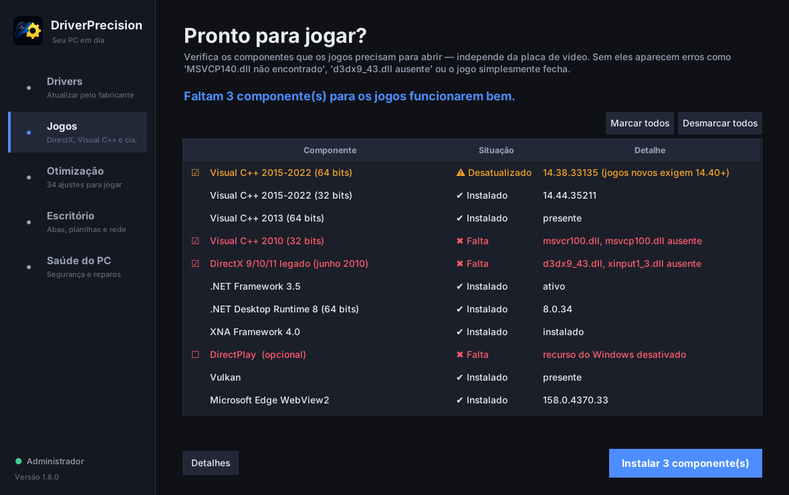
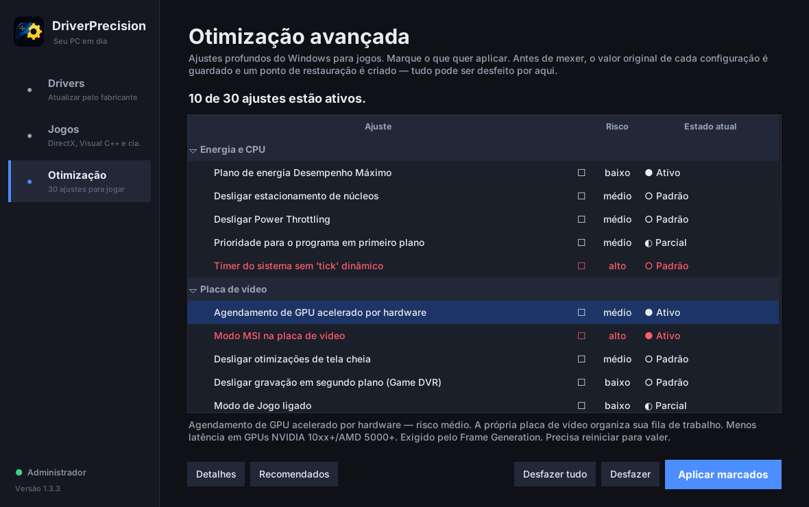
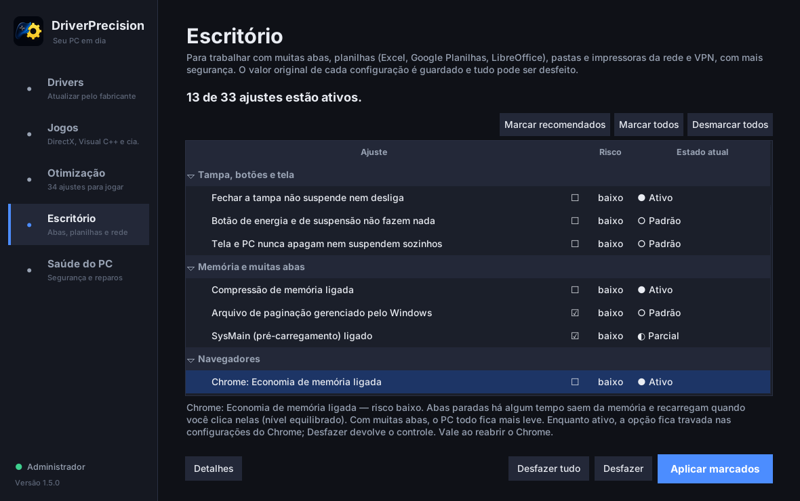
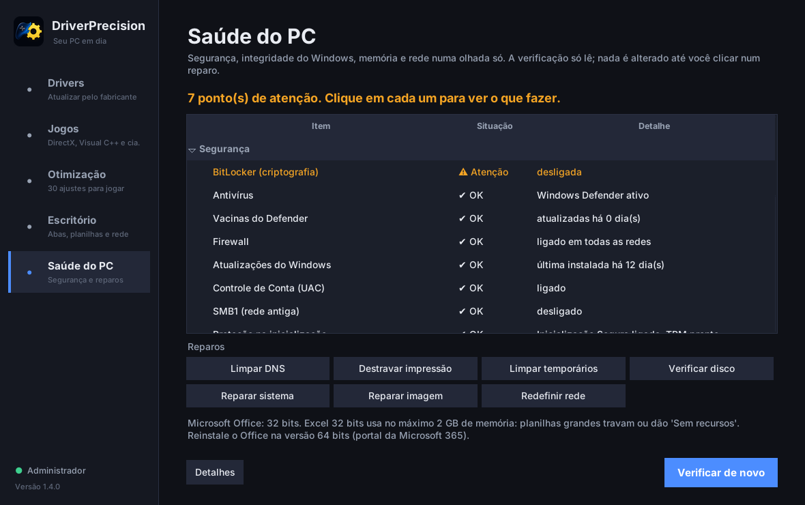

# Como o DriverPrecision funciona

Detalhes técnicos de cada tela, das fontes de driver e das regras de escolha. Para o resumo, veja o [README](../README.md).

- [Jogos](#jogos-tudo-o-que-os-jogos-precisam-para-abrir)
- [Otimização avançada](#otimização-avançada)
- [Escritório](#escritório-muitas-abas-planilhas-rede-e-segurança)
- [Saúde do PC](#saúde-do-pc)
- [Linha de comando](#uso-avançado-linha-de-comando)
- [Como identifica o driver certo](#como-identifica)
- [Como a instalação é protegida](#como-a-instalação-é-protegida)
- [Limitações conhecidas](#limitações-conhecidas)
- [Desenvolvimento](#desenvolvimento)
- [English](#english)

## Jogos: tudo o que os jogos precisam para abrir

Independente da potência do PC, jogos dependem de bibliotecas que o Windows não traz. Sem elas aparecem erros como *"MSVCP140.dll não encontrado"*, *"d3dx9_43.dll ausente"*, controle que não responde ou jogo que fecha sem aviso.



| Componente | Por que importa |
|---|---|
| Visual C++ 2005, 2008, 2010, 2012, 2013, 2015-2022 (32 e 64 bits) | Cada jogo usa a versão com que foi compilado; jogo 32 bits precisa da versão 32 bits mesmo no Windows 64. A 2015-2022 abaixo de **14.40** faz jogos novos fecharem ao abrir. |
| DirectX 9/10/11 legado (junho 2010) | O Windows 10/11 **não** traz d3dx9_43, XInput 1.3 e XAudio 2.7. |
| .NET Framework 3.5 e 4.8, .NET Desktop Runtime 8 e 10 | Launchers, ferramentas de mod e jogos indie. |
| XNA 4.0, OpenAL | Indies e clássicos (Terraria, Fez, emuladores...). |
| WebView2 | Launchers modernos ficam com tela branca sem ele. |
| DirectPlay (opcional), Vulkan (checagem) | Multiplayer de jogos antigos; Vulkan vem com o driver de vídeo. |

Tudo é baixado dos links oficiais (Microsoft; OpenAL da Creative) e só executa com assinatura digital válida do fabricante.

## Otimização avançada



Ajustes profundos que fazem diferença em jogo (não é "limpar arquivos temporários"). Cada um mostra o risco, o estado atual no seu PC e o que faz em português simples.

| Categoria | Ajustes |
|---|---|
| Energia e CPU | Plano Desempenho Máximo · estacionamento de núcleos · Power Throttling · prioridade do primeiro plano (`Win32PrioritySeparation`) · timer sem tick dinâmico (BCD) |
| Placa de vídeo | HAGS · modo MSI na GPU · otimizações de tela cheia · Game DVR · Modo de Jogo · economia de energia do PCIe (ASPM) |
| Agendador multimídia | `SystemResponsiveness` 0 e prioridade de GPU/CPU para a tarefa *Games* no MMCSS |
| Rede | `NetworkThrottlingIndex` · algoritmo de Nagle (TcpAckFrequency/TCPNoDelay) · compartilhamento P2P de atualizações · economia de energia do Wi-Fi |
| Mouse e teclado | aceleração do mouse · suspensão seletiva de USB · repetição do teclado |
| Windows | apps em segundo plano · efeitos visuais · Inicialização rápida · telemetria · anúncios e apps sugeridos · busca na web (Bing) · atraso da inicialização · hibernação |
| Disco | TRIM do SSD · registro de último acesso (NTFS) |
| Segurança x desempenho | Integridade de Memória (VBS/HVCI) — ganha FPS, mas reduz proteção; alguns anti-cheats exigem ligado |

**Segurança:** antes de aplicar, o valor original de cada chave vai para `%LOCALAPPDATA%\DriverPrecision\otimizacao_backup.json` e, se a Proteção do sistema estiver ligada, é criado um ponto de restauração. **Desfazer** devolve exatamente o que estava antes (inclusive apaga o que não existia). O ajuste de timer é bloqueado se o BitLocker estiver ativo, para não pedir a chave de recuperação no próximo boot.

Quer propor um ajuste? Ele é só um item de dados em [`driverprecision_otimiza.py`](../driverprecision_otimiza.py) — veja o [CONTRIBUTING](../CONTRIBUTING.md).

## Escritório: muitas abas, planilhas, rede e segurança



Mesmo motor da Otimização (backup do valor original, Desfazer, aviso de reinício), com ajustes pensados para trabalho:

| Categoria | Ajustes |
|---|---|
| Tampa, botões e tela | fechar a tampa não suspende · botões de energia/suspensão sem ação · tela e PC nunca apagam sozinhos (também na tela Otimização) |
| Memória e muitas abas | compressão de memória · arquivo de paginação automático · SysMain |
| Navegadores | Chrome: Economia de memória e fechar de verdade · Firefox: sem agente e telemetria em segundo plano |
| Excel e Office | Office sem animações · Office sem aceleração gráfica (só com sintoma) · LibreOffice: cache de imagens maior |
| Rede | descoberta de rede · unidades mapeadas em programas de administrador · impressora padrão fixa · placa de rede sem economia de energia · DNS pela VPN · Wi-Fi sem economia · sem P2P de atualizações |
| Segurança | extensão dos arquivos visível · Defender contra programas indesejados (PUA) · SMB1 desligado |
| Windows e disco | os ajustes gerais compartilhados com a Otimização |

Ajustes de programas que não estão instalados aparecem como "Não se aplica".

**PC de empresa:** se o computador está num domínio, no Entra ID (Azure AD) ou no Intune, o programa detecta e bloqueia (🔒) o que a TI costuma controlar — políticas, serviços, segurança e energia — para não brigar com a configuração da empresa. O resto continua disponível.

## Saúde do PC



Uma verificação só de leitura: versão da BIOS instalada (o programa não verifica, não baixa e não instala BIOS), antivírus e vacinas, firewall, atualizações, UAC, SMB1, BitLocker, Inicialização Segura e TPM, pontos de restauração, saúde e espaço dos discos, memória, tempo ligado, programas de inicialização, Office 32/64 bits, rede Pública/Particular e serviço de impressão. Cada item traz a dica do que fazer, em ordem de gravidade.

Reparos com um clique: limpar DNS · destravar impressão · limpar temporários · verificar disco (`chkdsk /scan`) · reparar sistema (`sfc /scannow`) · reparar imagem (`DISM /RestoreHealth`) · redefinir rede.

## Uso avançado (linha de comando)

Com o `.zip` e Python 3.10+:
```
python driverprecision.py                     # abre a janela
python driverprecision.py scan                # somente leitura, gera relatório
python driverprecision.py auto                # verifica e instala os recomendados, sem perguntas (admin)
python driverprecision.py baixar ID [ID ...]  # baixa e valida, não instala
python driverprecision.py instalar [ID ...]   # instala os IDs dados ou os recomendados (admin; pede "SIM", ou --sim)
```

Os IDs (`LEN:...`, `DELL:...`, `HP:...`, `WU:...`, `CAT:...`) aparecem no relatório.
Na linha de comando a saída fica em `DriverPrecision_saida\` (relatório HTML + `ultimo_scan.json`) na pasta atual; pela janela, em `%LOCALAPPDATA%\DriverPrecision\saida`. Cache em `%LOCALAPPDATA%\DriverPrecision\cache`.

Opções do scan: `--sem-oem`, `--sem-wu`, `--sem-catalogo`, `--nao-abrir`.

> **Privacidade:** o relatório e o `ultimo_scan.json` contêm o inventário e o número de série do seu PC. Não publique esses arquivos. Nenhum dado é enviado a terceiros: o programa só *baixa* catálogos públicos da Lenovo, Dell, HP e Microsoft.

## Como identifica

1. **Inventário (WMI):** fabricante, modelo, SKU, placa-mãe, BIOS e build do Windows. Para cada dispositivo: Hardware IDs, Compatible IDs, erro do Gerenciador de Dispositivos e driver em uso (versão, data, provedor, INF).
   - INF `oemNN.inf` = driver de fabricante. Outro nome = driver inbox (genérico) do Windows.
   - O casamento usa os Hardware IDs + os Compatible IDs que ainda identificam o chip (`VEN&DEV`, `VID&PID`). IDs só de classe (`PCI\CC_`, `USB\CLASS_`) nunca entram.

2. **Fontes, em ordem de confiança**

| # | Fonte | Chave de busca | Integridade |
|---|-------|----------------|-------------|
| 1 | Lenovo `catalog/<MT>_Win11.xml` | Machine Type + Hardware ID + versão do driver | SHA-256 do descritor e do instalador |
| 1 | Dell `CatalogPC.cab` | SystemSKU + `PCIInfo` + SO | MD5 + Authenticode |
| 1 | HP HPIA `platformList` / `ref/<plat>_64_<SO>.cab` | Platform ID (placa) + Hardware ID + SO | SHA-256 do softpaq |
| 2 | Windows Update (API WUA, só busca) | Hardware ID casado pelo próprio Windows | assinado pelo WU |
| 3 | Microsoft Update Catalog | Hardware ID mais específico (SUBSYS / VID&PID) | Authenticode |

   - **Catalog:** a busca do site é textual, então cada resultado é conferido na página do pacote. O Hardware ID do aparelho tem que estar **literalmente** em "Supported Hardware IDs". Se não estiver, ou se o provedor for a própria Microsoft (genérico), o pacote é descartado. Resultado que só bate no chip (`VEN&DEV` sem `SUBSYS`) não é recomendado.
   - **PC montado ou marca sem catálogo público:** usa as fontes 2 e 3 e mostra a placa-mãe para você buscar no site do fabricante dela.

   **Duas leis valem para toda verificação:**

   - **O driver é do fabricante da PEÇA, não só do PC.** O fabricante do chip sai do próprio Hardware ID (`VEN_8086` = Intel, `VEN_10EC` = Realtek, `VEN_1022` = AMD, `VEN_10DE` = NVIDIA...). O pacote do fabricante do PC só vale quando o catálogo dele lista **esta peça exata** (ID com `SUBSYS`): aí ele validou essa placa naquele modelo. Se a peça foi trocada — ex.: notebook que veio com Wi-Fi Realtek e recebeu uma placa Intel — o catálogo do PC não a reconhece, e o app usa o driver publicado pelo **fabricante da peça** (Intel), entregue pelo Windows Update ou pelo Catálogo da Microsoft. Pacote do PC que bate só pelo chip fica atrás do driver do fabricante da peça. Pacotes de terceiros que reempacotam driver de outro fabricante são descartados.
   - **Só versões estáveis.** Nada com beta, alpha, preview, pre-release, insider ou release candidate no nome, na versão ou no produto. Entre os drivers válidos, vale a versão estável mais nova.

3. **Status no relatório**

| Status | Significado |
|---|---|
| SEM DRIVER / INSTALAR | dispositivo com erro ou sem driver; INSTALAR = driver exato encontrado |
| SUBSTITUIR | está com driver inbox genérico e existe driver específico |
| ATUALIZAR | a fonte informa versão de driver mais nova que a instalada |
| VERIFICAR | a fonte só informa a versão do *pacote*, não a do driver: confira nas notas |
| GENÉRICO | inbox em classe crítica (vídeo, rede, áudio...) e nenhuma fonte publica driver específico |
| OK | igual ou mais novo, ou driver de classe padrão do Windows (USB hub, HID, NVMe padrão...) — nesses o driver de classe é o correto e o fabricante não publica outro |

Peça original (que o catálogo do fabricante do PC lista com ID exato) e o fabricante da peça tem versão mais nova:

| Tipo de peça | Vence | Por quê |
|---|---|---|
| Wi-Fi, Bluetooth, rede, vídeo | a versão estável mais nova (empate: a do fabricante do PC) | o pacote do PC é o mesmo driver da Intel/Realtek/NVIDIA/AMD repassado, com atraso |
| Áudio, chipset, Serial IO, Management Engine, controlador de disco, térmico, sensores, touchpad, câmera, biometria, leitor de cartão | a validada pelo fabricante do PC (o relatório mostra a mais nova) | o fabricante do PC ajusta o driver ao modelo e à BIOS |
| BIOS e firmware | nunca verificados, baixados nem instalados | a versão instalada aparece na Saúde do PC; a atualização a pessoa confere no site do fabricante |

Peça trocada ou que não consta no catálogo: o relatório avisa e recomenda o driver do fabricante da peça.

## Como a instalação é protegida

- Exige administrador. Antes de instalar, tenta criar um ponto de restauração do Windows (só funciona com a Proteção do sistema ligada, que o programa não altera); se não conseguir, pergunta se quer continuar.
- Todo arquivo baixado é validado (hash do catálogo do fabricante + assinatura digital válida). Se falhar, o arquivo é apagado e nada roda.
- **BIOS e firmware:** o programa não verifica, não baixa e não instala (nem pela linha de comando). A versão instalada aparece na Saúde do PC; a atualização é por conta da pessoa, pelo site oficial do fabricante, com o carregador conectado.
- Lenovo: `ExtractCommand` + `Install` do descritor oficial. Dell: `DUP.exe /s`. HP: `spXXXX.exe /s`. Catalog: `expand` + `pnputil /add-driver /install`. WU: API do Windows Update.

## Limitações conhecidas

- A Dell não publica Hardware ID de alguns pacotes (áudio, USB etc.): eles aparecem na seção "pacotes do modelo" como VERIFICAR.
- Lenovo consumer (IdeaPad/Legion) nem sempre tem catálogo público por MT: nesse caso usa WU + Catalog.
- GPUs dedicadas (NVIDIA/AMD) em PCs montados: o Catalog tem os drivers WHQL, mas o mais recente costuma sair antes no site do fabricante da GPU.
- Somente Windows 10/11 x64.

## Desenvolvimento

```
python -m unittest discover -s tests -v
```
Veja [CONTRIBUTING.md](../CONTRIBUTING.md) para adicionar um fabricante novo. Mudanças em [CHANGELOG.md](../CHANGELOG.md).

---

## English

**DriverPrecision** inventories a Windows PC and finds the *correct* driver for each device — the one published for that exact model and Hardware ID — never a generic package.

- **Sources, in order of trust:** the PC maker's official catalog (Lenovo by Machine Type, Dell by SystemSKU, HP by Platform ID), then Windows Update (search only), then the Microsoft Update Catalog. Every Catalog hit is verified against the package's official *Supported Hardware IDs* list; generic Microsoft drivers and chip-only (`VEN&DEV` without `SUBSYS`) matches are not recommended.
- **Download:** get `DriverPrecision.exe` (no Python needed) or the source `.zip` from [Releases](https://github.com/joao-eder/driverprecision/releases/latest).
- **Use:** double-click, accept the UAC prompt, click *Verificar agora* (scan), then *Instalar* (install). It creates a restore point, downloads each driver from the vendor, verifies hash + Authenticode signature and installs silently. Only confident matches with a proven newer version are auto-installed; BIOS/firmware never is. Power users: `python driverprecision.py scan | auto | baixar | instalar`.
- The UI and report are in Portuguese (pt-BR). Translations are welcome.
- **Privacy:** the report contains your PC's inventory and serial number; nothing is uploaded anywhere.

License: MIT.
